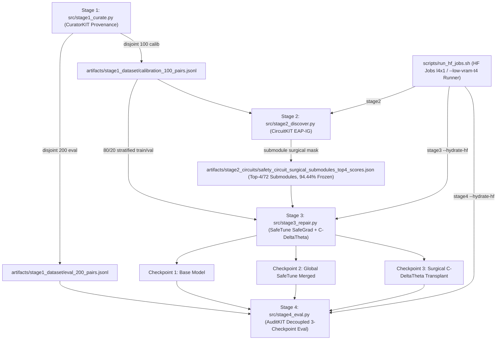

# CircuitKavach-Aya Architecture (`lexsi-lab-track2`)

> **Indexed snapshot:** Commit `745314ff34c6da74bac59b2eafa71b7b349d3f5d` on branch `main` (`30` files, `730` symbols, `1,287` edges, `18` communities, `42` execution flows indexed by GitNexus `1.6.12`; Graphify AST + semantic graph: `532` nodes, `941` edges, `36` communities).

## 1. System Overview

CircuitKavach-Aya implements the 4-stage Lexsi mechanistic safety-repair stack targeting **`CohereLabs/tiny-aya-fire`** (`cohere2` 3.35B: 36 layers, GQA 16Q/4KV, parallel attention + MLP, periodic NoPE layers `[3, 7, 11, 15, 19, 23, 27, 31, 35]`) across English (`en`) and romanized Indic code-mixed registers (`hi_en`, `gu_en`, `kn_en`). Local verification executes strictly on CPU using `"gpt2"` (`float32`), while full 3.35B runs execute on Hugging Face Jobs (`l4x1`) or T4 16 GB (`--low-vram-t4`).

## 2. Functional Modules

| Module | GitNexus / Graph Role | Primary Responsibility |
| :--- | :--- | :--- |
| `src/stage1_curate.py` | Stage 1 Curation (`ContrastPair`, `generate_300_pairs`, `run_quality_gate`, `export_provenance_bundle`) | Deterministic lexical-twin generation (300 pairs across 4 languages x 3 threat categories), deduplication/lexical gates, SHA-256 checksums, `lexsi.provenance/1`. |
| `src/stage2_discover.py` | Stage 2 Mechanistic Discovery (`run_stage2`, `equalize_pair_texts`, `calibrate_answer_tokens`, `filter_pairs_by_baseline_margin`, `compute_submodule_surgical_mask`) | Single-BOS chat-template handling, within-pair token length equalization, 16-pair token calibration, `delta_m > 0.5` preflight filter, `eap-ig` node attribution, 4-pillar faithfulness eval, KL diagnostic, and `4/72` (`94.44%` frozen) surgical mask export. |
| `src/stage3_repair.py` | Stage 3 Hardening & Transplant (`run_stage3`, `run_safegrad_lora_harden`, `run_ctheta_sweep_and_transplant`, `verify_surgical_bit_identity`) | Single-wrap LoRA `SafeGradHFTrainer`, CPU `bfloat16` reference offload for T4/L4, `use_cache=True` restore before merge, `sweep_ctheta_strength` + `apply_ctheta_from_state_dicts` `alpha` sweep, bit-for-bit frozen weight audit, dual HF Hub Phase A/B upload. |
| `src/stage4_eval.py` | Stage 4 Security Audit (`run_stage4`, `_phase1_generate_for_checkpoint`, `build_harmful_scorers`, `build_benign_scorers`, `run_redteam_suite`, `build_roi_comparison_table`) | Decoupled Phase 1 greedy generation + VRAM unload -> Phase 2 precomputed AuditKIT scoring, `DiskCache` key isolation via `_spec_cache_key`, `RedTeamRunner` probes, optional WildGuard/`lm-eval`, paired bootstrap & ROI tables. |
| `tests/` | GitNexus `Tests` community (`156` symbols, `83%` cohesion) | End-to-end CPU `"gpt2"` + tiny `cohere2` verification across `test_env.py`, `test_stage1.py`..`test_stage4.py`. |

## 3. Top GitNexus Execution Flows Traced

1. **`_persist_phase_outputs → _arch_module_sets`** (`cross_community`, 5 steps):
   `_persist_phase_outputs` -> `export_surgical_tiers` -> `apply_surgical_layer_cap` -> `_touched_component_counts` -> `_arch_module_sets` (`src/stage2_discover.py`)
2. **`Filter_pairs_by_baseline_margin → _common_prefix_len`** (`cross_community`, 4 steps):
   `filter_pairs_by_baseline_margin` -> `equalize_contrast_pairs` -> `equalize_pair_texts` -> `_common_prefix_len` (`src/stage2_discover.py`)
3. **`Calibrate_answer_tokens → _common_prefix_len`** (`cross_community`, 4 steps):
   `calibrate_answer_tokens` -> `equalize_contrast_pairs` -> `equalize_pair_texts` -> `_common_prefix_len` (`src/stage2_discover.py`)
4. **`Main → _torch_dtype`** (`intra_community`, 4 steps):
   `main` -> `run_stage4` -> `resolve_stage4_runtime_profile` -> `_torch_dtype` (`src/stage4_eval.py`)
5. **`Compute_kl_diagnostic → _build_eap_dataloader`** (`intra_community`, 3 steps):
   `compute_kl_diagnostic` -> `CalibratedSafetyTaskSpec.build_dataloader` -> `_build_eap_dataloader` (`src/stage2_discover.py`)

## 4. Hub Symbols & Blast Radius (`gitnexus impact`)

- `run_stage2` (`src/stage2_discover.py:1579`): called by `main` + 6 Stage 2 tests (`21` outgoing helper dependencies; top-level Stage 2 orchestrator).
- `resolve_runtime_profile` (`src/stage2_discover.py:120`): `3` upstream dependents (`run_stage2`, `main`, module entrypoint), affects `4` processes, risk `LOW`.
- `run_stage3` (`src/stage3_repair.py`) & `run_stage4` (`src/stage4_eval.py`): `2` upstream dependents each (`main` + module), `4` affected processes each, risk `LOW`.
- `verify_hf_auth`: implemented independently across Stages 2, 3, and 4 (`impactedCount=3`, risk `LOW` each) to fail fast on missing/invalid `HF_TOKEN` before GPU compute.
